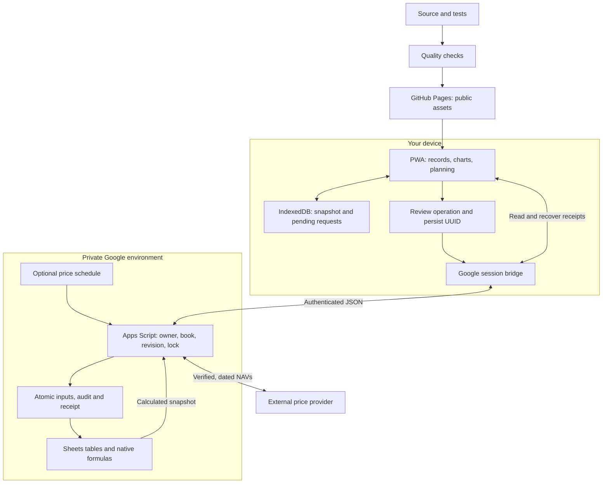

# Finance

[](https://github.com/manuuelmarin/finances/actions/workflows/pages.yml)

Personal finance PWA for cash, investments, budgets and goals. GitHub Pages serves the interface; private Google Sheets stores the data.

[Open app](https://manuuelmarin.github.io/finances/) · [Install / update](https://manuuelmarin.github.io/finances/install.html) · [TODOs](TODO.md) · [History](History.md)

**App 3.11.1 · API 3.3.0 · workbook model 3.**

## End to end



After a confirmed write, the app automatically refreshes every view from one coherent snapshot. Failed or stale reads are retried without resending the confirmed operation; explicit reporting filters remain selected. PWA 3.11.1 remains compatible with backend/Bridge 3.10.4–3.11.0, so these interface changes need no private Google update.

Account cards compare the report-date balance with the opening balance for **Hoy, 1D, 7D, 15D, 1M, 3M, 6M and 1A**. Each opening is the preceding day's close, or the initial balance on the first tracking day. Movements on the opening date are included. Calendar-month/year offsets use the same day, clamped at month-end; missing history stays unknown. Hoy and 1D coincide when yesterday's net balance change is zero. Resolved and discarded requests remain in the collapsed activity history. Pending, uncertain and post-confirmation readback requests stay visible until resolved; no receipts or UUIDs are deleted.

The backend selects the workbook. The PWA caches public assets; financial snapshots and pending requests remain in the device profile. Missing values stay unknown.

Movement locations accept a suggested city or any new text (for example Valencia). Saved cities are reused as suggestions after readback and reload; creation, correction and linked-movement editing share the same input. Accounts, categories and other validated references keep their existing creation and validation flows. Mobile filters constrain native date editors to their grid tracks, stack at narrow widths and retain 44px touch targets. Table actions stay outside horizontal scrolling, and the table can be focused and scrolled with a keyboard.

Accounts start with a total, followed by Unicaja, Bankinter, physical cash, MyInvestor and Trade Republic. Investment cards show the same eight opening-date comparisons for the whole portfolio and every product, including contributions and withdrawals. They compare current native market value with holdings valued at the latest NAV known before each opening; they do not substitute cost basis for price or remove cash flows. Their reference date is the book's valuation date. Missing holdings or prices keep the comparison unknown, and a new zero-unit position can have a zero opening value. Product/range filters below control the separate return analytics. See [appearance](docs/APPEARANCE.md) for the original M bank mark and 24 themes.

## Setup

1. Convert the complete [blank workbook](templates/finances-model-3.xlsx) to Google Sheets. Preserve its [tables and formulas](docs/WORKBOOK.md).
2. Follow the installer to add its three files (the generated `Code.gs`, `Bridge.html`, and `appsscript.json`) to a private Apps Script project. Set `OWNER_EMAIL`, `ENVIRONMENT=test` and `TEST_SPREADSHEET_ID` in Script Properties.
3. Run `prepareApplication`, then `checkApplication`. Check calculation, summary and source results; `ok:true` alone is insufficient.
4. Deploy as **Me**, access **Only me**. Connect its private URL in the app.

For production, retain the test setup and use a separate project with `ENVIRONMENT=production`, `PRODUCTION_SPREADSHEET_ID` and a different `TEST_SPREADSHEET_ID`. Keep all private configuration outside GitHub.

Updates require replacing the installer's changed files, running preparation/checks and publishing **New version** of the existing deployment. Pages does not update Apps Script. Add records through the app: it expands capacity automatically. After changing table structure directly in Sheets, run preparation again.

## Recovery

Back up the complete native workbook and the script code/configuration before updates. Resolve pending requests in their original deployment before switching books or clearing storage. An uncertain write retains its original content and UUID: query its receipt before retrying. Restore into a separate copy and reconcile before resuming.

[Workbook and prices](docs/WORKBOOK.md) · [Return and risk calculations](docs/PORTFOLIO-METRICS.md) · [Security](SECURITY.md)

## Development

Node.js 24+:

```sh
npm ci --ignore-scripts
npx playwright install --with-deps chromium webkit
npm run build
node tools/serve.cjs
```

Open `http://127.0.0.1:4173`. Run `npm run check` and `npm run audit` before a PR. Tests use fictional data; private Google and physical-device acceptance remain separate. Capacity tests cover every editable table and longer histories; portfolio tests check that splitting identical holdings preserves return and risk results. Browser suites cover the current installer, channel, recovery and mobile flows. Deployment publishes the exact public files produced and tested by `quality`.

| Directory      | Purpose                                          |
| -------------- | ------------------------------------------------ |
| `web/`         | UI, charts, API client, queue and PWA            |
| `apps-script/` | Authorization, transactions, formulas and prices |
| `tools/`       | Builds, local server and checks                  |
| `tests/`       | Financial, recovery and browser tests            |
| `templates/`   | Empty workbook                                   |
| `TODO/`        | Feature proposals                                |

Edit source files and rebuild generated installer, CSP and service-worker assets. Keep existing release hashes immutable. Use Conventional Commits and merge through a checked PR; deployment depends on `quality`.
